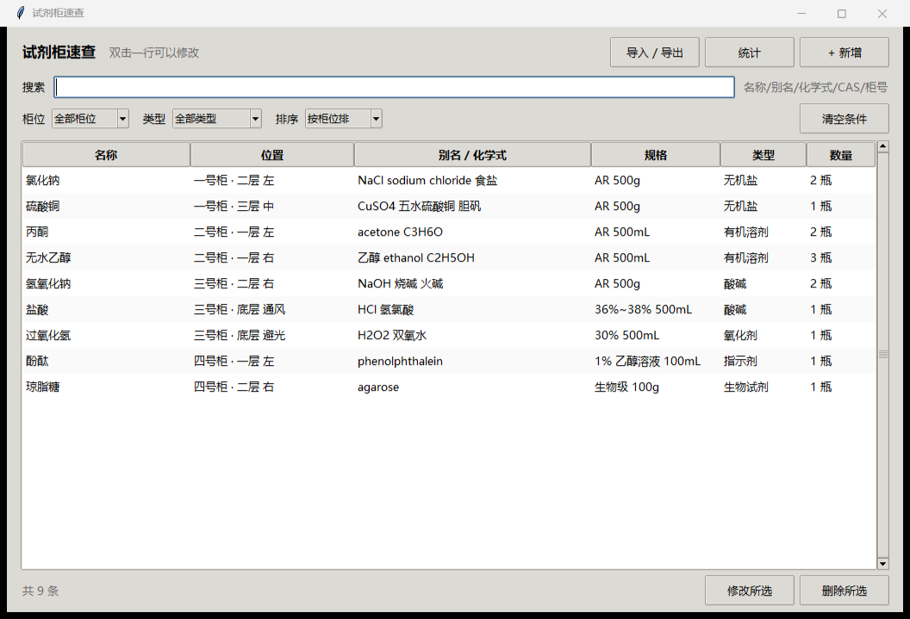

# 试剂柜速查 · AQ-reagent-cabinet

一个给实验室用的**试剂位置速查**小工具：把试剂和耗材录进去，按名称、别名、化学式、CAS 号或柜号一搜，
立刻看到它在哪个柜子、哪一层。



## 它解决什么问题

实验台上找一瓶氯化钠，常见流程是：问一圈人 → 翻 Excel → 找到“一号柜”但不知道在几层。
这个工具只做一件事：**输入「氯化钠」或「NaCl」，直接显示「一号柜 · 二层 左」**。

刻意不做批号、出入库流水、审批流——那些会让每次录入变重，最后大家又回去用 Excel。
如果你确实需要完整库存系统，可以看 [docs/design-notes.md](docs/design-notes.md) 里的规划。

## 功能

- **搜索**：中文名 / 别名 / 英文名 / 化学式 / CAS / 柜号，多关键词用空格分隔
- **记录**：名称、别名、CAS、规格、类型、柜号、柜内位置、数量、备注
- **筛选与排序**：按柜位、类型筛选；按柜位（顶层→底层）、名称、类型、最近更新排序
- **统计**：每个柜子有多少种、按类型分布
- **导入导出**：JSON 备份、CSV（Excel 可直接打开）、CSV 批量导入（按「名称+柜号+位置」去重）
- **纯本地**：数据存在 exe 同目录的 `data.json`，不联网、不上传
- **单实例**：重复双击不会开第二个窗口，只会把已打开的窗口切到前面

## 快速开始

### 使用打包好的 exe（Windows）

1. 在 [Releases](../../releases) 下载最新压缩包
2. 解压到任意文件夹，双击 `试剂柜速查.exe`
3. 数据在同目录 `data.json`；整个文件夹拷到 U 盘或别的电脑就能继续用

> exe 没有数字签名，Windows 可能提示「未知发布者」：点「更多信息 → 仍要运行」。
> 如果提示「无法验证发布者」且文件属性里有「解除锁定」，勾选即可。

### 从源码运行

只需要 Python 3.9+，tkinter 是标准库，**不需要安装任何第三方依赖**：

```bash
python src/app.py
```

首次启动会自动写入 9 条示例数据，方便直接试搜索。

## 数据格式

`data.json` 与 exe 同目录：

```json
{
  "app": "reagent-locator",
  "savedAt": "2026-10-27T19:54:53+08:00",
  "items": [
    {
      "id": "seed0",
      "name": "氯化钠",
      "alias": "NaCl sodium chloride 食盐",
      "cas": "7647-14-5",
      "spec": "AR 500g",
      "category": "无机盐",
      "cabinet": "一号柜",
      "slot": "二层 左",
      "qty": "2 瓶",
      "note": "",
      "updatedAt": 0
    }
  ]
}
```

字段含义、CSV 表头、导入去重规则见 [docs/data-format.md](docs/data-format.md)。

## 批量导入

把现有 Excel 清单另存为 CSV（UTF-8），表头写成：

```
名称,别名,CAS号,规格,类型,柜号,位置,数量,备注
```

然后在程序里「导入 / 导出 → 从 CSV 批量导入」。同名同柜同位会更新，不会重复添加。

## 构建 exe

```bash
pip install pyinstaller
python tools/build.py
```

产物在 `dist/试剂柜速查/`，含 exe 与 `_internal`。也可以直接用 GitHub Actions
（见 `.github/workflows/build-exe.yml`），每次推送自动构建并上传产物。

## 目录结构

```
├─ src/app.py              桌面版主程序（tkinter，无第三方依赖）
├─ web/index.html          网页版（单文件，数据存在浏览器 localStorage）
├─ assets/                 图标与截图
├─ examples/data.sample.json  9 条示例数据
├─ docs/                   数据格式说明、早期设计笔记
├─ tools/                  图标生成、示例数据生成、打包脚本
└─ tests/test_app.py       逻辑自检（搜索/筛选/去重/落盘）
```

## 网页版

`web/index.html` 是同一套交互的单文件实现：双击即可在浏览器里用，不需要服务器、不需要 Python。
数据存在浏览器的 localStorage 里，和桌面版的 `data.json` **互不相通**，适合快速体验或没装 Python 的环境。

## 已知限制

- 单机使用：多人共享需要内网小服务（规划见 docs/design-notes.md）
- 未实现：批号与有效期、出入库流水、审批流
- 打包脚本面向 Windows（源码本身跨平台，macOS/Linux 可直接 `python src/app.py`）

## 许可

[MIT](LICENSE)
